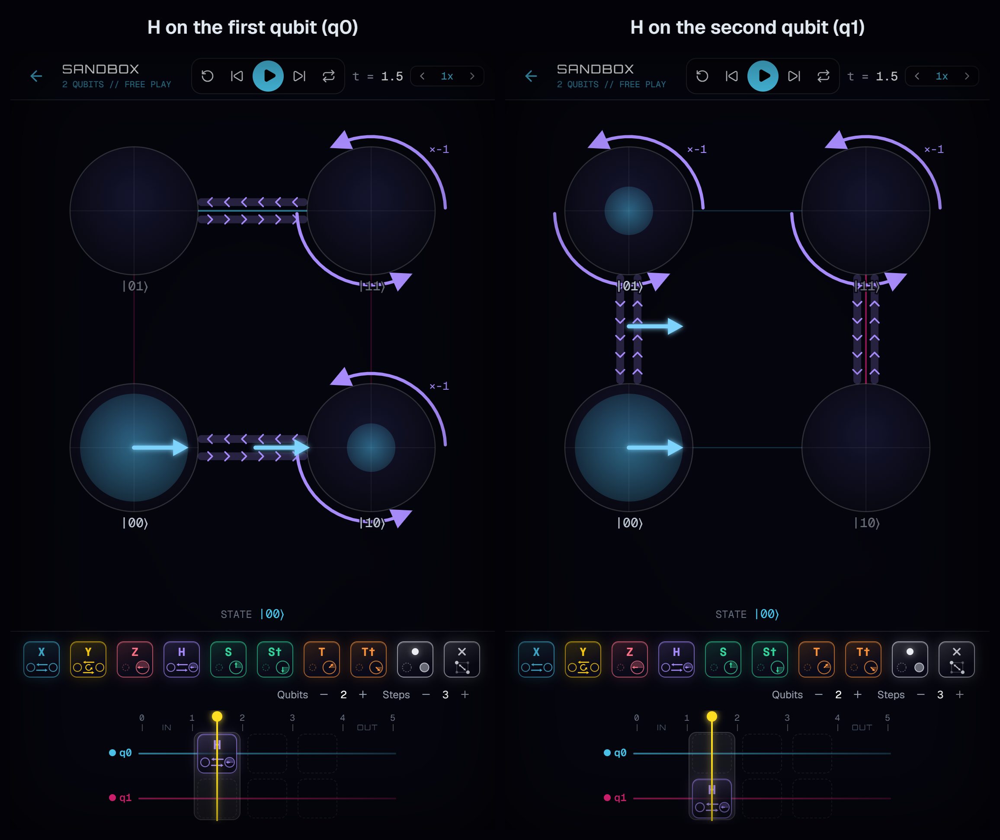
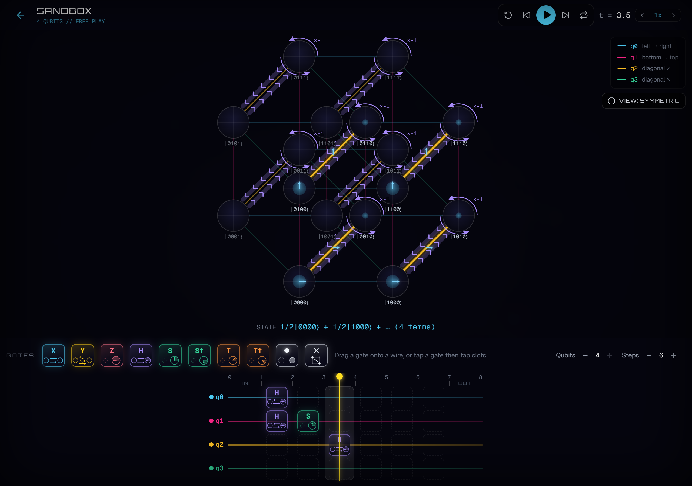

# Computation Game

A puzzle game about bits and qubits, where every basis state is a circle on the corners of one
hypercube: a line of two circles for one bit, a square for two, a cube for three. The shape
itself never moves; what changes in time is what's on it. Each wire of the circuit is one
direction of the shape, and a gate on that wire moves amplitude along that direction, so it
looks like a circle sliding to the other circle, a line sliding onto the opposite line, or a
square sliding onto the opposite square. The campaign stops at three qubits for now; the
Sandbox goes up to four, drawn flat in the tesseract's most symmetric view (two octagons, each
qubit one direction of the same length). Every gate tile carries a small picture of what the gate
does, in the same language as the stage.

Every amplitude is an arrow: the complex number itself, drawn in the complex plane (right = +1,
up = +i), with the filled disk's area as the probability. When a gate sends pieces of amplitude
to the same corner they add head-to-tail, so interference is something you watch happen.





Play it at **https://soren-o.github.io/computation-game/**

Still in development. It started as a Google AI Studio export; the first commit is that export.

## Run it

Requires Node 20.19+.

```bash
npm install
npm run dev        # http://localhost:3000
```

`npm test` runs the unit tests (the simulator, the animation, and a check that every puzzle's
reference solution solves it). `npm run build` typechecks and builds into `dist/`. Pushing to
`main` deploys to GitHub Pages through `.github/workflows/deploy.yml`.

## Where things are

- `src/game/quantum.ts`: state-vector simulator (any qubit count; the game uses up to 4), gates, circuit columns.
- `src/game/animation.ts`: how arrows travel, line up head-to-tail and merge during a gate.
- `src/game/hypercube.ts`: corner positions, rotation and perspective.
- `src/game/levels.ts`: the campaign. Puzzles are data; circuits use a one-character-per-wire
  notation (`'H.'`, `'@X'`, `'@@X'`, `'##'`).
- `src/game/tutorials.tsx` and `src/game/archives.ts`: instructor text and the Data Bank.
- `src/components/level/`: the stage, the circuit editor and the transport controls.

Fonts (Orbitron, Geist, Geist Mono) are bundled from Fontsource under the SIL Open Font License.

## License

MIT. See [LICENSE](LICENSE): use, copy, change and build on it freely.
